# 🔥 Admitrack — Go-Live Startup Audit Report

**Auditor Perspective:** Senior Staff Engineer (Top 1% SWE)
**Date:** 2026-11-27
**Scope:** Full-stack audit — Next.js Backend + Web UI + Flutter Mobile + Supabase PostgreSQL
**Goal:** Transform an unstructured prototype into a production-grade SaaS platform that a small team can ship in weeks and scale confidently.

---

## Executive Verdict

> [!CAUTION]
> **This codebase is a working prototype, not a production platform.** It has 5 P0 security vulnerabilities that must be fixed before any public deployment, zero automated tests, no CI/CD pipeline beyond APK builds, and several architectural anti-patterns that will cause cascading failures under real multi-tenant load. The existing blueprint identifies many structural issues correctly, but **misses 14 critical categories** that will block or sabotage a startup launch.

### What the Blueprint Got Right ✅
The [SCALABILITY_AND_ARCHITECTURE_BLUEPRINT.md](file:///C:/Users/PRASAD/.gemini/antigravity/brain/573024a8-2aa3-425f-bba5-f7c4fffa003e/SCALABILITY_AND_ARCHITECTURE_BLUEPRINT.md) correctly identifies:
- Fat controllers with inline Prisma (the 552-line `students/route.ts`)
- In-memory cache incoherence
- Synchronous heavy tasks (PDF, backup)
- Flutter monolithic ApiService
- Need for 3-tier architecture, cursor pagination, structured logging

### What the Blueprint Completely Misses ❌
This audit covers **14 categories not addressed** in the blueprint:

```mermaid
flowchart LR
    subgraph COVERED["Blueprint Covers"]
        A["3-Tier Architecture"]
        B["Caching Strategy"]
        C["Logging & Tracing"]
        D["Flutter Refactor"]
    end
    subgraph MISSING["THIS AUDIT Adds"]
        E["🔴 P0 Security Holes"]
        F["🔴 Zero Tests"]
        G["🔴 No CI/CD"]
        H["🔴 No Env Validation"]
        I["🟠 CORS Wide Open"]
        J["🟠 No Rate Limiting on Auth"]
        K["🟠 Multi-Tenancy Leaks"]
        L["🟠 No API Versioning"]
        M["🟡 UI/UX & Design System"]
        N["🟡 Monitoring & Alerting"]
        O["🟡 Documentation"]
        P["🟡 Mobile Hardcoded URLs"]
        Q["🟡 Database Backup In-Band"]
        R["🟡 Small Team Workflow"]
    end
    COVERED -.-> MISSING
```



---

## 🔴 PRIORITY 0 — Fix Before Going Live (Week 1)

These are ship-blockers. Any one of them can destroy user trust, leak data, or take the platform down.

---

### 1. HARDCODED JWT SECRET + PASSWORD BACKDOOR

**Severity: 🔴 CRITICAL — Active Exploit Path**

**Finding:** [auth.ts L4](file:///x:/Prasad%20projact%20works/Admitrack/src/lib/auth.ts#L4)
```typescript
const JWT_SECRET = process.env.JWT_SECRET || 'super-secret-fallback-key-for-local-dev';
```

**Finding:** [login/route.ts L34](file:///x:/Prasad%20projact%20works/Admitrack/src/app/api/auth/login/route.ts#L34)
```typescript
// Fallback for admin if password was typed as 'admin', 'admin123', or 'Psd@1986'
if (!isMatch && user.role === 'ADMIN' && (cleanPassword === 'Psd@1986' || cleanPassword === 'admin' || cleanPassword === 'admin123')) {
  isMatch = true;
```

**Finding:** [api_service.dart L31](file:///x:/Prasad%20projact%20works/Admitrack/mobile_app/lib/services/api_service.dart#L31)
```dart
static const String _jwtSecret = 'super-secret-fallback-key-for-local-dev';
```

**Impact:**
- The Flutter app ships the JWT secret in the APK binary — anyone can decompile the APK and forge tokens for ANY user, including ADMIN.
- Three hardcoded admin passwords bypass bcrypt entirely. This is a master key baked into source code.
- If `JWT_SECRET` env var is not set in production, every deployment uses the publicly known fallback.

**Fix:**
| Action | Effort |
|--------|--------|
| Remove the `\|\| 'super-secret...'` fallback. Crash on startup if `JWT_SECRET` is not set. | 5 min |
| Delete the entire plaintext password backdoor block (L33-L41 in login route). | 5 min |
| Remove `_jwtSecret` from Flutter entirely. The mobile app should NEVER have the server secret. | 5 min |
| Rotate the JWT_SECRET in production immediately. | 10 min |
| Force-reset all admin passwords to strong bcrypt hashes. | 15 min |

---

### 2. CORS: ALLOW-ORIGIN `*` ON ALL API ROUTES

**Severity: 🔴 CRITICAL**

**Finding:** [next.config.ts L20](file:///x:/Prasad%20projact%20works/Admitrack/next.config.ts#L20)
```typescript
{ key: "Access-Control-Allow-Origin", value: "*" },
{ key: "Access-Control-Allow-Headers", value: "*" },
```

**Impact:** Any website on the internet can make authenticated requests to your API if a user is logged in. Combined with the cookie-based auth (`httpOnly`, `sameSite: 'lax'`), this enables cross-site data exfiltration from any domain.

**Fix:** Restrict to known origins:
```typescript
{ key: "Access-Control-Allow-Origin", value: process.env.ALLOWED_ORIGIN || "https://yourdomain.com" },
```

---

### 3. TOKEN IN QUERY PARAMETERS

**Severity: 🔴 HIGH**

**Finding:** [auth.ts L28-L30](file:///x:/Prasad%20projact%20works/Admitrack/src/lib/auth.ts#L28-L30)
```typescript
const queryToken = url.searchParams.get('token') || url.searchParams.get('auth_token');
if (queryToken) return queryToken.trim();
```

**Impact:** Auth tokens in URLs are logged in browser history, server access logs, Vercel function logs, proxy logs, and Referer headers. Anyone with log access sees every user's token.

**Fix:** Remove query param token extraction entirely. Use only `Authorization: Bearer` header and httpOnly cookies.

---

### 4. BACKUP ENDPOINT: CRON SECRET IN QUERY STRING + DEFAULT SECRET

**Severity: 🔴 HIGH**

**Finding:** [backup/route.ts L11](file:///x:/Prasad%20projact%20works/Admitrack/src/app/api/cron/backup/route.ts#L11)
```typescript
const CRON_SECRET = process.env.CRON_SECRET || 'MY_SUPER_SECRET_CRON_KEY_123';
```
```typescript
const secret = searchParams.get('secret');  // Secret in URL!
```

**Impact:** 
- Default secret means anyone can trigger a full database dump to your Google Drive if the env var isn't set.
- Full database dump (all models, all data, all passwords) is accessible via a single GET request.
- The backup runs in-band in the web request thread — a large DB will timeout on serverless.

**Fix:**
- Use Vercel Cron's built-in `CRON_SECRET` header auth, not query params.
- Remove the default fallback secret.
- Move backup to a background worker / separate script.

---

### 5. ZERO AUTOMATED TESTS

**Severity: 🔴 P0 for a Startup**

**Finding:** No test files exist in the entire project (`src/`, `mobile_app/`). No Jest, Vitest, or Flutter test configuration. No test scripts in `package.json`.

**Impact:** Every code change is a game of Russian roulette. With 552-line route handlers doing complex multi-role authorization, any refactor can silently break data isolation between tenants/roles. You will ship bugs to production that a 10-line test would catch.

**Fix (Minimum Viable Testing — 2 days):**

| Layer | What to Test | Tool |
|-------|-------------|------|
| API Auth | Token validation, role-based access, data isolation between employees | Vitest + supertest |
| Student CRUD | Create, duplicate phone check, pagination, filter combos | Vitest |
| Login | Correct/incorrect password, disabled user, rate limiting | Vitest |
| Flutter | OfflineService queue/dequeue, ApiService error handling | `flutter_test` |
| E2E Smoke | Login → Add Student → View List → Logout | Playwright |

---

## 🟠 PRIORITY 1 — Fix in Week 2 (Pre-Launch Hardening)

---

### 6. NO REQUEST VALIDATION (Zod/Schemas)

**Finding:** Every API route does manual checks like `if (!employeeId || !password)`. No schema validation on request bodies. The 552-line students route trusts all input shapes blindly.

The [students POST route](file:///x:/Prasad%20projact%20works/Admitrack/src/app/api/students/route.ts#L48-L73) creates a student by directly spreading `data.*` fields — any extra fields sent by a client are silently ignored but could cause confusion or be used for prototype pollution.

**Fix:** Add Zod schemas at the API boundary:
```typescript
// modules/students/dtos/create-student.dto.ts
export const CreateStudentDto = z.object({
  studentName: z.string().min(1).max(200),
  phone: z.string().regex(/^\d{10}$/),
  group: z.string().min(1),
  // ... whitelist every field
});
```

---

### 7. NO ENVIRONMENT VARIABLE VALIDATION

**Finding:** The app reads 10+ env vars with `process.env.X || 'fallback'` patterns. If any critical var is missing in production, the app silently uses unsafe defaults instead of failing fast.

No `.env` validation exists (no `zod`, no `t3-env`, no `envalid`).

**Fix:** Add a startup validation file:
```typescript
// src/core/config/env.ts
import { z } from 'zod';

const envSchema = z.object({
  DATABASE_URL: z.string().url(),
  JWT_SECRET: z.string().min(32),
  CRON_SECRET: z.string().min(16),
  // ... all required vars
});

export const env = envSchema.parse(process.env);
```
Import this at the top of your app — crash loudly if anything is missing.

---

### 8. NO RATE LIMITING ON AUTH ENDPOINTS

**Finding:** The login endpoint at [login/route.ts](file:///x:/Prasad%20projact%20works/Admitrack/src/app/api/auth/login/route.ts) has zero rate limiting. An attacker can brute-force every employee's password at thousands of attempts per second.

The SPX integration has a good [rate-limiter.ts](file:///x:/Prasad%20projact%20works/Admitrack/src/lib/integrations/spx/rate-limiter.ts) — but it's only used for SPX endpoints, not the main auth system.

**Fix:** Apply rate limiting to `/api/auth/login`:
- 5 attempts per minute per IP
- 10 attempts per minute per employeeId
- Use the existing SPX rate limiter pattern or `@upstash/ratelimit`

---

### 9. MULTI-TENANCY DATA ISOLATION GAPS

**Finding:** The [students GET route](file:///x:/Prasad%20projact%20works/Admitrack/src/app/api/students/route.ts#L82-L552) has 470 lines of hand-written authorization logic with complex `whereClause.AND.push()` chains. This is fragile and hard to audit:

- **ADMIN** sees everything — no college-scoping
- **COLLEGE** role does 3 separate DB queries to build the where clause
- **TELECALLER** relies on `assignedEmployees` array — if empty, falls through to `{ id: 'none' }` hack
- The `{ id: 'none' }` impossible condition pattern is used as a data-isolation guard — if Prisma ever changes `cuid()` generation, this breaks

**Risk:** A single missed `AND.push()` in any branch means one tenant's data leaks to another.

**Fix:** Extract authorization into a middleware/guard pattern:
```typescript
// core/guards/data-scope.guard.ts
export function buildDataScope(session: Session): Prisma.StudentWhereInput {
  switch (session.role) {
    case 'ADMIN': return { collegeId: session.collegeId }; // Scope admin to their college
    case 'EMPLOYEE': return { employeeId: session.employeeId };
    // ...deterministic, testable, single-responsibility
  }
}
```

---

### 10. NO MIDDLEWARE / ROUTE PROTECTION

**Finding:** No `middleware.ts` file exists in the project. Every API route manually extracts and verifies the token:
```typescript
const token = await getAuthToken(req, 'auth_token');
if (!token) return NextResponse.json({ error: 'Unauthorized' }, { status: 401 });
const payload = verifyToken(token) as { employeeId: string } | null;
if (!payload || !payload.employeeId) return NextResponse.json({ error: 'Unauthorized' }, { status: 401 });
```
This exact block is copy-pasted across 60+ route files. If you need to change the auth flow, you must update 60 files.

**Fix:** Create `src/middleware.ts`:
```typescript
export function middleware(request: NextRequest) {
  if (request.nextUrl.pathname.startsWith('/api/') && !PUBLIC_ROUTES.includes(path)) {
    const token = request.cookies.get('auth_token')?.value
      || request.headers.get('authorization')?.split(' ')[1];
    if (!token || !verifyToken(token)) {
      return NextResponse.json({ error: 'Unauthorized' }, { status: 401 });
    }
  }
}
```

---

### 11. NO CI/CD PIPELINE

**Finding:** Only one GitHub Action exists: [build-apk.yml](file:///x:/Prasad%20projact%20works/Admitrack/.github/workflows/build-apk.yml) for Flutter APK builds. No CI for the Next.js backend. No:
- Lint on PR
- Type-check on PR
- Test on PR  
- Automatic Vercel preview deployments
- Database migration checks
- Dependency vulnerability scanning

**Fix (Minimum Viable CI — 1 day):**
```yaml
# .github/workflows/ci.yml
name: CI
on: [push, pull_request]
jobs:
  check:
    runs-on: ubuntu-latest
    steps:
      - uses: actions/checkout@v4
      - uses: actions/setup-node@v4
        with: { node-version: 20, cache: npm }
      - run: npm ci
      - run: npx tsc --noEmit          # Type check
      - run: npm run lint               # ESLint
      - run: npx vitest run             # Tests (once added)
      - run: npx prisma validate        # Schema check
```

---

## 🟡 PRIORITY 2 — Ship Quality & Team Velocity (Weeks 2-4)

---

### 12. MONOLITHIC PAGE FILES (UI/UX & Maintainability)

**Finding:** Page file sizes are dangerously large:

| File | Size | Problem |
|------|------|---------|
| [college-admission-management/page.tsx](file:///x:/Prasad%20projact%20works/Admitrack/src/app/products/college-admission-management/page.tsx) | **140 KB** | Product/marketing page — entire website in one file |
| [college/dashboard/page.tsx](file:///x:/Prasad%20projact%20works/Admitrack/src/app/college/dashboard/page.tsx) | **91 KB** | Dashboard with charts, stats, tables all inline |
| [college/reports/page.tsx](file:///x:/Prasad%20projact%20works/Admitrack/src/app/college/reports/page.tsx) | **86 KB** | Report generation UI |
| [employee/relatives/page.tsx](file:///x:/Prasad%20projact%20works/Admitrack/src/app/employee/relatives/page.tsx) | **76 KB** | Relatives management |
| [employee/institution-visits/page.tsx](file:///x:/Prasad%20projact%20works/Admitrack/src/app/employee/institution-visits/page.tsx) | **63 KB** | Institution visits |

A 140 KB React component is ~3,500 lines. This means:
- **No reusable components** — every page re-implements buttons, modals, tables, cards
- **No design system** — styles are inline or duplicated
- **Git merge conflicts** are constant — two devs can't work on the same feature area
- **Performance** — the entire page must be parsed and rendered, even for a small UI change

**Fix:**
1. Extract a component library: `Button`, `Modal`, `DataTable`, `Card`, `FilterBar`, `StatusBadge`
2. Create a shared `src/components/ui/` directory (or use shadcn/ui)
3. Each page should be <200 lines, composing components
4. Use Tailwind CSS properly instead of inline styles

---

### 13. NO DESIGN SYSTEM / UI LIBRARY

**Finding:** No UI library is installed (`package.json` has only `lucide-react` for icons). All styling is either:
- Inline `style={{}}` objects
- Raw CSS in `globals.css`
- Duplicated across pages

For a startup going live, your UI is your first impression. Inconsistent spacing, colors, and interactions scream "unfinished prototype."

**Fix:** Install and adopt shadcn/ui (zero-runtime, copy-paste components):
```bash
npx shadcn@latest init
npx shadcn@latest add button card dialog table input select badge
```
This gives you a professional, consistent design system in 30 minutes.

---

### 14. FLUTTER: HARDCODED LOCALHOST URLs

**Finding:** [api_service.dart L14-L21](file:///x:/Prasad%20projact%20works/Admitrack/mobile_app/lib/services/api_service.dart#L14-L21)
```dart
static String get baseUrl {
  if (kIsWeb) return 'http://127.0.0.1:5000';
  return defaultTargetPlatform == TargetPlatform.android
      ? 'http://10.0.2.2:3000'
      : 'http://127.0.0.1:3000';
}
```

**Impact:** The production APK cannot connect to your production server. The base URL must come from build-time configuration or a `.env` file, not hardcoded localhost.

**Fix:**
```dart
// Use flutter_dotenv or compile-time env
static String get baseUrl {
  const env = String.fromEnvironment('API_URL', defaultValue: 'http://10.0.2.2:3000');
  return env;
}
// Build: flutter build apk --dart-define=API_URL=https://api.admitrack.com
```

---

### 15. DATABASE BACKUP RUNS IN HTTP REQUEST THREAD

**Finding:** [backup/route.ts](file:///x:/Prasad%20projact%20works/Admitrack/src/app/api/cron/backup/route.ts) dumps ALL tables, compresses with gzip, and uploads to Google Drive — all inside a single HTTP GET handler with a **separate `PrismaClient` instance**.

On Vercel, functions have a 10-second timeout (free) or 60-second (pro). A database with 50K+ students will timeout.

**Fix:** 
- Use Supabase's built-in `pg_dump` for backups (they handle it)
- Or move to a scheduled GitHub Action that runs `tsx scripts/db-backup.ts`
- Remove the HTTP endpoint entirely

---

### 16. NO ERROR BOUNDARY / GLOBAL ERROR HANDLER

**Finding:** Every API route has its own try/catch with `console.error` and a generic `{ error: 'Internal server error' }`. No structured error codes, no stack traces in dev, no Sentry/error tracking.

The [students route L549-L551](file:///x:/Prasad%20projact%20works/Admitrack/src/app/api/students/route.ts#L549-L551) doesn't even log the error:
```typescript
} catch (error) {
    return NextResponse.json({ error: 'Internal server error' }, { status: 500 });
}
```

**Fix:** Create a wrapper:
```typescript
// core/api/with-error-handler.ts
export function withErrorHandler(handler: RouteHandler) {
  return async (req: Request, ctx: any) => {
    try {
      return await handler(req, ctx);
    } catch (error) {
      const requestId = crypto.randomUUID();
      logger.error({ err: error, requestId, path: req.url });
      // Sentry.captureException(error, { extra: { requestId } });
      return NextResponse.json(
        { error: 'Internal server error', requestId },
        { status: 500 }
      );
    }
  };
}
```

---

### 17. NO API VERSIONING

**Finding:** All routes are at `/api/students`, `/api/auth/login`, etc. The SPX integration correctly uses `/api/integrations/spx/v1/` — but the core API doesn't.

When you change response shapes or add required fields, every Flutter app in the wild breaks simultaneously.

**Fix:** Version your API:
```
/api/v1/students
/api/v1/auth/login
```
This lets you deploy breaking changes to `/api/v2/` while old mobile apps still work on `/api/v1/`.

---

### 18. NO MONITORING, ALERTING, OR HEALTH CHECKS

**Finding:** No `/api/health` endpoint. No uptime monitoring. No alerting on errors. If the database connection drops at 3 AM, nobody knows until users complain.

**Fix:**
1. Add `/api/health` that checks DB connectivity:
```typescript
export async function GET() {
  try {
    await prisma.$queryRaw`SELECT 1`;
    return NextResponse.json({ status: 'ok', db: 'connected' });
  } catch {
    return NextResponse.json({ status: 'degraded', db: 'disconnected' }, { status: 503 });
  }
}
```
2. Set up **BetterUptime** or **UptimeRobot** (free tier) to ping `/api/health` every 60 seconds
3. Add **Sentry** for error tracking (free for 5K events/month)

---

### 19. PRISMA CLIENT: NO CONNECTION POOL TUNING

**Finding:** [prisma.ts](file:///x:/Prasad%20projact%20works/Admitrack/src/lib/prisma.ts) creates a bare `new PrismaClient()` with zero configuration:
```typescript
export const prisma = globalForPrisma.prisma || new PrismaClient();
```

No connection pool limits, no query logging in dev, no timeout settings.

**Fix:**
```typescript
export const prisma = globalForPrisma.prisma || new PrismaClient({
  log: process.env.NODE_ENV === 'development' ? ['query', 'warn', 'error'] : ['error'],
  datasources: {
    db: { url: process.env.DATABASE_URL },
  },
});
```
And ensure Supavisor connection pooler URL is used for `DATABASE_URL` with `?pgbouncer=true&connection_limit=10`.

---

## 📋 Comprehensive Checklist — What You Need vs What You Have

| Category | What a Production SaaS Needs | Current State | Priority |
|----------|------------------------------|---------------|----------|
| **Auth Security** | Strong JWT secret, no backdoors | ❌ Hardcoded secret + 3 backdoor passwords | 🔴 P0 |
| **CORS** | Restricted to known origins | ❌ `*` wildcard | 🔴 P0 |
| **Input Validation** | Schema validation on all inputs | ❌ Manual checks only | 🟠 P1 |
| **Rate Limiting** | On auth and sensitive endpoints | ❌ Only on SPX integration | 🟠 P1 |
| **Automated Tests** | Unit + Integration + E2E | ❌ Zero tests | 🔴 P0 |
| **CI/CD Pipeline** | Lint → Type-check → Test → Deploy | ❌ APK build only | 🟠 P1 |
| **Env Validation** | Fail-fast on missing config | ❌ Silent fallback defaults | 🟠 P1 |
| **Middleware** | Centralized auth/logging | ❌ Copy-pasted in 60+ routes | 🟠 P1 |
| **Error Tracking** | Sentry / structured errors | ❌ `console.error` only | 🟡 P2 |
| **Structured Logging** | JSON logs with request IDs | ❌ `console.log` | 🟡 P2 |
| **Health Checks** | `/api/health` for monitoring | ❌ None | 🟡 P2 |
| **Uptime Monitoring** | External ping + alerting | ❌ None | 🟡 P2 |
| **Design System** | Consistent UI components | ❌ Inline styles, 140KB pages | 🟡 P2 |
| **API Versioning** | `/api/v1/` prefix | ❌ Unversioned (except SPX) | 🟡 P2 |
| **Database Backups** | Automated, out-of-band | ⚠️ In HTTP thread, default secret | 🟠 P1 |
| **Caching** | Distributed (Redis/Upstash) | ⚠️ In-memory `Map` (stale across instances) | 🟡 P2 |
| **Background Jobs** | Queue for heavy tasks | ❌ All synchronous | 🟡 P2 |
| **Multi-Tenancy** | Deterministic data isolation | ⚠️ 470-line hand-written per route | 🟠 P1 |
| **Mobile Prod URLs** | Build-time API URL config | ❌ Hardcoded `localhost` | 🟠 P1 |
| **Mobile Offline Sync** | Write-ahead log + sync engine | ⚠️ Queue exists, no auto-sync | 🟡 P2 |
| **Documentation** | API docs, onboarding guide | ❌ None | 🟡 P2 |
| **Dependency Security** | `npm audit`, Dependabot | ❌ Not configured | 🟡 P2 |
| **PWA Config** | `next-pwa` v5+ or Serwist | ⚠️ Using deprecated `next-pwa` | 🟡 P2 |
| **Performance** | Cursor pagination, selective fields | ⚠️ Offset pagination, full SELECTs | 🟡 P2 |

---

## 🗺️ Recommended Execution Plan for a Small Team

> [!IMPORTANT]
> **Small team constraint acknowledged.** The plan below is designed for 1-2 developers working full-time. It prioritizes *safety* over *architecture beauty*. Ship safe first, refactor in flight.

### Sprint 0: Security Lockdown (2 days)
```
Day 1 AM: Remove JWT secret fallback + Flutter embedded secret + password backdoor
Day 1 AM: Fix CORS to restrict origins
Day 1 AM: Remove token-in-query-params
Day 1 PM: Add env validation (crash on missing vars)
Day 1 PM: Rotate JWT_SECRET in production, force-reset admin passwords
Day 2 AM: Add rate limiting to /api/auth/login
Day 2 AM: Fix backup endpoint (remove default secret, use header auth)
Day 2 PM: Add middleware.ts for centralized auth
Day 2 PM: Configure Flutter production API URL via --dart-define
```

### Sprint 1: Safety Net (3 days)
```
Day 3: Set up Vitest + write auth/login tests (5-10 tests)
Day 4: Write student CRUD + data isolation tests (10 tests)
Day 5: Set up CI pipeline (lint + typecheck + test on PR)
        Add /api/health, set up UptimeRobot
        Add Sentry free tier for error tracking
```

### Sprint 2: Architecture Foundation (5 days)
```
Day 6-7: Extract withAuth() wrapper + withErrorHandler() 
         Refactor top 5 route files to use service layer
Day 8-9: Install shadcn/ui, extract 10 shared components
         Break the 140KB page into components
Day 10:  Add Zod DTOs to student create/update
         Add API versioning (/api/v1/)
```

### Sprint 3: Performance & Polish (5 days)
```
Day 11-12: Cursor pagination for student lists
           Selective projections
           Upstash Redis cache for config data
Day 13:    Move backup + PDF to background (GitHub Action or QStash)
Day 14-15: Flutter: Configure Riverpod for state management
           Implement auto-sync for offline queue
           Break ApiService into feature-specific services
```

---

## 🔮 Future-Proofing Recommendations

> [!TIP]
> These are not blockers but will save you enormous pain as you scale past your first 10 colleges.

### 1. Multi-Tenant Database Architecture
Currently, all colleges share one flat database with `collegeId` column filtering. At 50+ colleges, consider:
- **Row-Level Security (RLS)** in Supabase PostgreSQL
- Set `app.current_college_id` at session level, enforce in Postgres policies
- This makes data isolation *impossible to bypass* at the database level, regardless of application bugs

### 2. Feature Flags
Use a simple feature flag system (even a JSON file) so you can:
- Roll out new features to one college before all
- Kill a broken feature without deploying
- A/B test UI changes

### 3. Analytics & Product Metrics
You have no way to know:
- How many students are added per day across all colleges
- Which features employees actually use
- Where users drop off in the mobile app
Add PostHog (free, self-hostable) or Mixpanel free tier.

### 4. API Documentation
Generate OpenAPI/Swagger docs from your Zod schemas. This becomes essential when:
- Other integrations (like SPX) need to consume your API
- New team members join
- You build a public API for college integrations

### 5. Database Migrations in CI
Add `prisma migrate deploy` to your CI/CD. Currently, migrations are manual — a forgotten migration in production means data loss or downtime.

---

> [!NOTE]
> **Verdict:** The Admitrack codebase has solid domain knowledge and feature coverage — it's clear you understand the business deeply. The gap is purely in engineering practices. The 5 P0 security fixes take less than a day. The safety net (tests + CI) takes 3 days. After that, you have a platform you can confidently put in front of paying customers. Everything else is progressive improvement while you're live.
>
> **The existing blueprint is a good architectural north star. This audit gives you the survival checklist to get there alive.**
