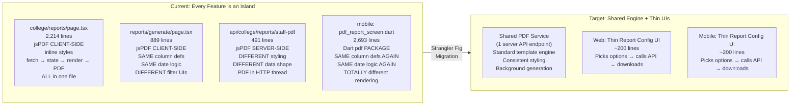
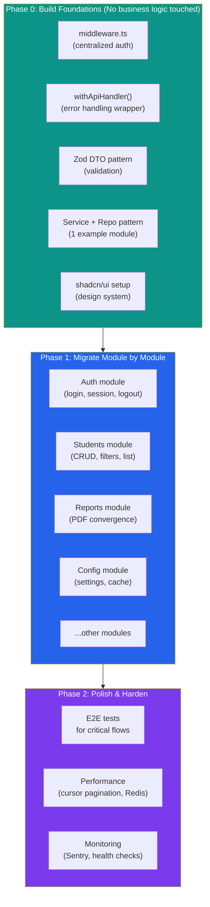
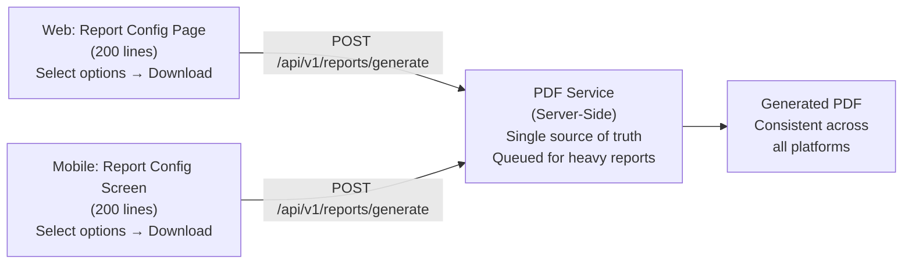
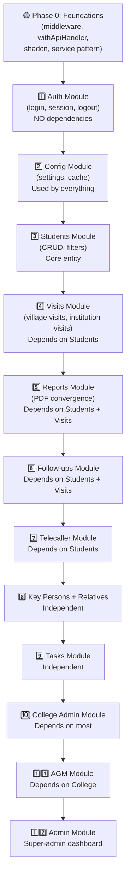

# 🏗️ Admitrack — Structured Migration Mechanism

**Purpose:** Transform a working prototype into a production-grade startup platform **without breaking business features**, using a disciplined mechanism a small team can follow sprint-by-sprint.

---

## The Core Problem (Visualized)

Right now, every feature is a self-contained monolith. The same logic is re-implemented differently everywhere:



### What's Duplicated Across the Codebase

| Duplicated Thing | Where It Exists | Times Repeated |
|-----------------|----------------|---------------|
| Auth token extraction + verification | 7+ API route files | ~7x |
| Inline `style={{}}` objects | 18 page files | ~18x |
| PDF column definitions (`sno`, `studentName`, `fatherName`...) | 3 files (2 web + 1 mobile) | 3x |
| Date formatting logic (`formatDate`, `getDateKey`) | Web reports + Mobile reports | 2x |
| Sidebar navigation component | 4 files (`AdminSidebar`, `EmployeeSidebar`, `CollegeSidebar`, `TelecallerSidebar`) | 4x |
| Bottom navigation component | 3 files (`BottomNav`, `AgmBottomNav`, `TelecallerBottomNav`) | 3x |
| Student list filtering logic | `students/route.ts` (552 lines) + multiple pages | Multiple |
| Config resolution (`resolveConfig`) | Web pages + Mobile `ApiService` | Everywhere |

---

## The Strategy: Strangler Fig Pattern

> [!IMPORTANT]
> **Never rewrite. Always migrate.** The Strangler Fig pattern means: build the new structure *alongside* the old code, then redirect each feature to use the new structure one at a time. At no point do you have a "big bang" day where everything changes.



---

## Phase 0: Build 5 Foundations (Before Touching Business Logic)

> [!TIP]
> **These 5 things are built ONCE and then used by every module during migration. Total effort: ~3 days. Zero risk to existing features because nothing imports them yet.**

### Foundation 1: `middleware.ts` — Centralized Auth Gate

**Current pain:** Auth boilerplate copy-pasted in 7+ routes.

```
src/middleware.ts   ← NEW FILE (Next.js auto-detects this)
```

```typescript
// src/middleware.ts
import { NextResponse } from 'next/server';
import type { NextRequest } from 'next/server';

const PUBLIC_PATHS = ['/api/auth/login', '/api/health', '/api/app-version', '/login', '/'];
const PUBLIC_PREFIXES = ['/api/integrations/spx/', '/api/cron/'];

export function middleware(request: NextRequest) {
  const { pathname } = request.nextUrl;
  
  // Skip public routes
  if (PUBLIC_PATHS.includes(pathname) || PUBLIC_PREFIXES.some(p => pathname.startsWith(p))) {
    return NextResponse.next();
  }
  
  // Skip non-API routes (pages handle their own auth via layout)
  if (!pathname.startsWith('/api/')) {
    return NextResponse.next();
  }
  
  // Check auth
  const token = request.cookies.get('auth_token')?.value
    || request.headers.get('authorization')?.replace('Bearer ', '');
  
  if (!token) {
    return NextResponse.json({ error: 'Unauthorized' }, { status: 401 });
  }
  
  // Pass token forward so route handlers don't re-extract it
  const headers = new Headers(request.headers);
  headers.set('x-auth-token', token);
  
  return NextResponse.next({ headers });
}

export const config = {
  matcher: '/api/:path*',
};
```

**Impact:** Every new and migrated route gets auth for free. Old routes keep working unchanged.

---

### Foundation 2: `withApiHandler()` — Error + Logging Wrapper

```
src/core/api/with-api-handler.ts   ← NEW FILE
```

```typescript
// src/core/api/with-api-handler.ts
import { NextRequest, NextResponse } from 'next/server';
import { verifyToken } from '@/lib/auth';
import { ZodSchema, ZodError } from 'zod';

interface HandlerOptions {
  roles?: string[];        // Required roles (empty = any authenticated user)
  bodySchema?: ZodSchema;  // Zod schema for request body validation
}

interface AuthenticatedContext {
  session: { id: string; employeeId: string; name: string; role: string; collegeId?: string | null };
  body?: any;
}

type Handler = (req: NextRequest, ctx: AuthenticatedContext) => Promise<NextResponse>;

export function withApiHandler(handler: Handler, options: HandlerOptions = {}) {
  return async (req: NextRequest) => {
    const requestId = crypto.randomUUID();
    const startTime = Date.now();

    try {
      // 1. Auth (middleware already checked token exists, we verify here)
      const token = req.headers.get('x-auth-token') 
        || req.cookies.get('auth_token')?.value
        || req.headers.get('authorization')?.replace('Bearer ', '');
      
      if (!token) {
        return NextResponse.json({ error: 'Unauthorized', requestId }, { status: 401 });
      }

      const payload = verifyToken(token) as AuthenticatedContext['session'] | null;
      if (!payload?.employeeId) {
        return NextResponse.json({ error: 'Invalid token', requestId }, { status: 401 });
      }

      // 2. Role check
      if (options.roles?.length && !options.roles.includes(payload.role)) {
        return NextResponse.json({ error: 'Forbidden', requestId }, { status: 403 });
      }

      // 3. Body validation
      let body: any = undefined;
      if (options.bodySchema) {
        const raw = await req.json();
        body = options.bodySchema.parse(raw);
      }

      // 4. Execute handler
      const result = await handler(req, { session: payload, body });
      
      // 5. Log success
      const latency = Date.now() - startTime;
      console.log(JSON.stringify({ 
        requestId, method: req.method, path: req.nextUrl.pathname, 
        userId: payload.employeeId, latency, status: result.status 
      }));

      return result;

    } catch (error: any) {
      const latency = Date.now() - startTime;
      
      if (error instanceof ZodError) {
        return NextResponse.json({ 
          error: 'Validation failed', 
          details: error.errors, 
          requestId 
        }, { status: 400 });
      }

      console.error(JSON.stringify({ 
        requestId, method: req.method, path: req.nextUrl.pathname,
        error: error.message, stack: error.stack, latency 
      }));

      return NextResponse.json({ error: 'Internal server error', requestId }, { status: 500 });
    }
  };
}
```

**What this gives you:**
- ✅ Auth verified in 1 line
- ✅ Role-based access in 1 line
- ✅ Body validated with Zod automatically
- ✅ Structured JSON logs with request ID
- ✅ Consistent error responses everywhere
- ✅ Zero boilerplate in route handlers

**Before (552 lines):**
```typescript
export async function GET(req: Request) {
  try {
    const token = await getAuthToken(req, 'auth_token');
    if (!token) return NextResponse.json({ error: 'Unauthorized' }, { status: 401 });
    const payload = verifyToken(token) as { employeeId: string; role: string } | null;
    if (!payload || !payload.employeeId) return NextResponse.json({ error: 'Unauthorized' }, { status: 401 });
    // ... 540 lines of mixed auth + business + data access
  } catch (error) {
    return NextResponse.json({ error: 'Internal server error' }, { status: 500 });
  }
}
```

**After (~30 lines):**
```typescript
export const GET = withApiHandler(async (req, { session }) => {
  const students = await studentService.getStudents(session, req.nextUrl.searchParams);
  return NextResponse.json(students);
}, { roles: ['ADMIN', 'EMPLOYEE', 'COLLEGE', 'TELECALLER', 'AGM'] });
```

---

### Foundation 3: Zod DTO Pattern

```
src/core/dtos/   ← NEW DIRECTORY
```

One example file per module. Create these as you migrate:

```typescript
// src/core/dtos/student.dto.ts
import { z } from 'zod';

export const CreateStudentDto = z.object({
  studentName: z.string().min(1, 'Student name is required').max(200),
  phone: z.string().regex(/^\d{10}$/, 'Phone must be 10 digits'),
  group: z.string().min(1),
  fatherName: z.string().optional(),
  // ... whitelist every accepted field
});

export const StudentQueryDto = z.object({
  page: z.coerce.number().min(1).default(1),
  limit: z.coerce.number().min(1).max(500).default(50),
  search: z.string().optional(),
  date: z.string().optional(),
  // ... every filter parameter
});

export type CreateStudentInput = z.infer<typeof CreateStudentDto>;
```

---

### Foundation 4: Service + Repository Pattern (1 Example)

```
src/modules/students/
├── student.service.ts    ← Business logic
├── student.repo.ts       ← Pure Prisma queries
└── student.dto.ts        ← Zod schemas (or import from core/dtos)
```

```typescript
// src/modules/students/student.repo.ts
import { prisma } from '@/lib/prisma';
import { Prisma } from '@prisma/client';

export const studentRepo = {
  findMany(where: Prisma.StudentWhereInput, options: { skip: number; take: number }) {
    return prisma.student.findMany({
      where,
      orderBy: { createdAt: 'desc' },
      ...options,
    });
  },
  
  count(where: Prisma.StudentWhereInput) {
    return prisma.student.count({ where });
  },

  findByPhone(phone: string) {
    return prisma.student.findFirst({
      where: { phone: { contains: phone } },
    });
  },
};
```

```typescript
// src/modules/students/student.service.ts
import { studentRepo } from './student.repo';
import { buildDataScope } from '@/core/guards/data-scope';

export const studentService = {
  async getStudents(session: Session, params: URLSearchParams) {
    const scope = buildDataScope(session);
    const filters = buildFilters(params);
    const where = { AND: [scope, ...filters] };
    
    const page = Number(params.get('page') || '1');
    const limit = Number(params.get('limit') || '50');
    
    const [students, total] = await Promise.all([
      studentRepo.findMany(where, { skip: (page - 1) * limit, take: limit }),
      studentRepo.count(where),
    ]);
    
    return { students, total, page, limit };
  },
};
```

**Key point:** You build this for ONE module (students), verify it works, then apply the same pattern to every other module during migration.

---

### Foundation 5: Design System (shadcn/ui Setup)

```bash
# One-time setup (~30 minutes)
npx shadcn@latest init
npx shadcn@latest add button card dialog table input select badge tabs
```

Then create your app-specific wrappers:

```
src/shared/
├── components/
│   ├── ui/              ← shadcn primitives (auto-generated)
│   ├── DataTable.tsx     ← Reusable table with pagination, sorting, filters
│   ├── FilterBar.tsx     ← Reusable filter controls
│   ├── PageHeader.tsx    ← Consistent page title + breadcrumbs
│   ├── StatusBadge.tsx   ← Lead status display
│   ├── RoleSidebar.tsx   ← SINGLE sidebar that takes role as prop
│   └── RoleBottomNav.tsx ← SINGLE bottom nav that takes role as prop
├── hooks/
│   ├── useAuth.ts        ← Current user session hook
│   ├── usePagination.ts  ← Pagination state management
│   └── useFilters.ts     ← Filter state management
└── utils/
    ├── dates.ts          ← ALL date formatting logic (shared web + API)
    └── pdf-columns.ts    ← Shared column definitions
```

**Impact of `RoleSidebar`:** Replaces 4 sidebar files with 1 configurable component:
```typescript
// src/shared/components/RoleSidebar.tsx
const MENU_ITEMS: Record<string, MenuItem[]> = {
  ADMIN: [{ name: 'Dashboard', path: '/admin', icon: LayoutDashboard }, ...],
  COLLEGE: [{ name: 'Dashboard', path: '/college/dashboard', icon: LayoutDashboard }, ...],
  // ...
};

export function RoleSidebar({ role }: { role: string }) {
  const items = MENU_ITEMS[role] || [];
  // ... one implementation
}
```

---

## The PDF Convergence Plan

> [!WARNING]
> **This is the worst duplication in the codebase.** PDF generation logic exists in 4 completely different implementations with 3 different PDF libraries, totaling ~6,000 lines of near-identical business logic.

### Current State (3 Incompatible Engines)

| Location | Library | Runs Where | Lines | Business Logic |
|----------|---------|-----------|-------|---------------|
| [college/reports/page.tsx](file:///x:/Prasad%20projact%20works/Admitrack/src/app/college/reports/page.tsx) | `jsPDF` | Browser (client-side) | 2,214 | Column defs, date grouping, star leads, filters |
| [reports/generate/page.tsx](file:///x:/Prasad%20projact%20works/Admitrack/src/app/reports/generate/page.tsx) | `jsPDF` | Browser (client-side) | 889 | Same column defs, same date logic, different UI |
| [api/college/reports/staff-pdf/route.ts](file:///x:/Prasad%20projact%20works/Admitrack/src/app/api/college/reports/staff-pdf/route.ts) | `jsPDF` | Server (Node.js) | 491 | Staff-specific, different styling, blocks HTTP thread |
| [mobile: pdf_report_screen.dart](file:///x:/Prasad%20projact%20works/Admitrack/mobile_app/lib/screens/employee/pdf_report_screen.dart) | `pdf` (Dart) | Mobile device | 2,693 | SAME column defs re-implemented in Dart |

### Target: Single Server-Side PDF API



**How it works:**
1. Web and Mobile send a JSON config: `{ reportType, dateRange, columns, filters }`
2. Server generates PDF with consistent styling using `jsPDF` (keep what works)
3. Returns PDF bytes for download
4. For large reports, return a job ID and generate in background

**Migration steps:**
1. Extract shared column definitions + date logic into `src/shared/utils/pdf-columns.ts`
2. Create `src/modules/reports/report.service.ts` with the PDF generation logic
3. Create `POST /api/v1/reports/generate` endpoint that calls the service
4. Update web pages to call the API instead of generating client-side
5. Update Flutter to call the API instead of using the Dart `pdf` package
6. Delete ~5,000 lines of duplicated PDF logic

---

## Module-by-Module Migration Tracker

> [!NOTE]
> **Rule: One module per sprint.** Migrate in dependency order. Each module follows the same checklist (see below). Never start a new module until the current one passes all tests.

### Migration Order (Dependency-Aware)



### Detailed Migration Status Table

| # | Module | Key Files | Current Lines | Target Lines | Priority | Status |
|---|--------|-----------|---------------|-------------|----------|--------|
| 0 | **Foundations** | `middleware.ts`, `withApiHandler`, shadcn | 0 (new) | ~300 | 🔴 Do First | ⬜ Not Started |
| 1 | **Auth** | `auth.ts`, `session.ts`, `login/route.ts` | ~130 | ~80 | 🔴 | ⬜ Not Started |
| 2 | **Config** | `cache.ts`, `config/route.ts` | ~150 | ~100 | 🔴 | ⬜ Not Started |
| 3 | **Students** | `students/route.ts` (552 lines!) | ~600 | ~100 route + ~200 service | 🟠 | ⬜ Not Started |
| 4 | **Visits** | `village_visits`, `institution-visits` | ~3,100 (Dart) + ~200 (API) | ~400 each | 🟠 | ⬜ Not Started |
| 5 | **Reports/PDF** | 4 files, 3 languages, ~6,300 lines | ~6,300 | ~800 total | 🟠 | ⬜ Not Started |
| 6 | **Follow-ups** | `followups/page.tsx` | ~600 | ~200 | 🟡 | ⬜ Not Started |
| 7 | **Telecaller** | `telecaller/*` | ~1,200 | ~400 | 🟡 | ⬜ Not Started |
| 8 | **Key Persons** | `key-persons/*` | ~800 | ~300 | 🟡 | ⬜ Not Started |
| 9 | **Tasks** | `tasks/*` | ~600 | ~200 | 🟡 | ⬜ Not Started |
| 10 | **College Admin** | `college/*` (dashboard 91KB!) | ~3,000 | ~600 | 🟡 | ⬜ Not Started |
| 11 | **AGM** | `agm/*` | ~1,500 | ~400 | ⬜ | ⬜ Not Started |
| 12 | **Admin** | `admin/*` | ~800 | ~300 | ⬜ | ⬜ Not Started |

---

## Per-Module Migration Checklist

> Every module migration follows this EXACT sequence. No skipping steps.

### ☐ Step 1: Write tests for current behavior (RED)
```
Before touching ANY code:
☐ Write 3-5 integration tests for the existing API endpoint
☐ Tests must pass against the CURRENT code
☐ This is your safety net — if tests break after migration, you've introduced a bug
```

### ☐ Step 2: Create the new service + repo (GREEN)
```
☐ Create src/modules/{module}/
☐ Create {module}.repo.ts — extract Prisma queries from route handler
☐ Create {module}.service.ts — extract business logic from route handler
☐ Create {module}.dto.ts — define Zod schemas for inputs
```

### ☐ Step 3: Create the new thin route (SWITCH)
```
☐ Create new route handler using withApiHandler()
☐ Route calls service, service calls repo
☐ Route handler is <30 lines
☐ Run tests — they must still pass
```

### ☐ Step 4: Migrate the UI (REFACTOR)
```
☐ Replace inline styles with shadcn/ui components
☐ Extract reusable components from the page
☐ Page file drops below 200 lines
☐ Manual smoke test in browser
```

### ☐ Step 5: Cleanup (DELETE)
```
☐ Remove old inline Prisma queries
☐ Remove old auth boilerplate
☐ Remove old inline styles
☐ Run all tests
☐ Update migration tracker status
```

---

## Small Team Workflow Rules

### Git Branch Strategy
```
main              ← Always deployable, production
├── dev           ← Integration branch
├── foundation/*  ← Phase 0 work (middleware, design system)
├── migrate/*     ← Module migrations (migrate/students, migrate/reports)
└── fix/*         ← Bug fixes that can't wait
```

**Rule:** Every migration branch starts from `dev` and merges back to `dev`. `dev` → `main` happens at sprint end after full smoke test.

### The "One Module, One Sprint" Rule

```
Week 1: Migrate Module N
  - Mon: Write tests for current behavior
  - Tue-Wed: Create service + repo + DTO
  - Thu: Create thin route, run tests
  - Fri: Migrate UI, smoke test, merge

Week 2: Migrate Module N+1
  ... repeat ...
```

### The Rule of Three

Before creating ANYTHING new, ask:
1. **Does this already exist?** → Check `src/shared/`, `src/core/`, `src/modules/`
2. **Can I extract it from an existing file?** → If a 2,000-line file has the logic, extract it
3. **Will 3+ places use this?** → If yes, put it in `shared/`. If no, keep it in the module.

### The "New Code Contract"

**Every new file must follow these constraints:**

| Constraint | Rule |
|-----------|------|
| Max file length | 200 lines for pages, 300 lines for services |
| Max function length | 50 lines |
| Auth | Via `withApiHandler()`, never inline |
| Validation | Via Zod DTO, never manual `if (!x)` |
| Styling | Via Tailwind/shadcn, never `style={{}}` |
| Error handling | Via `withApiHandler()`, never try/catch in routes |
| Database access | Via repo only, never `prisma.` in routes or services |
| Testing | Minimum 3 tests per API endpoint |

---

## Recommended Target Directory Structure

```
src/
├── middleware.ts                    ← Centralized auth gate
├── core/                            ← Cross-cutting infrastructure
│   ├── api/
│   │   └── with-api-handler.ts      ← Error + auth + validation wrapper
│   ├── config/
│   │   └── env.ts                   ← Env validation (Zod)
│   ├── guards/
│   │   └── data-scope.ts            ← Multi-tenant data isolation
│   └── errors/
│       └── domain-errors.ts         ← NotFoundError, ForbiddenError, etc.
│
├── modules/                         ← Domain modules (DDD-lite)
│   ├── auth/
│   │   ├── auth.service.ts
│   │   └── auth.dto.ts
│   ├── students/
│   │   ├── student.service.ts
│   │   ├── student.repo.ts
│   │   └── student.dto.ts
│   ├── visits/
│   ├── reports/
│   │   ├── report.service.ts        ← SINGLE PDF generation engine
│   │   ├── templates/               ← PDF templates (day report, staff report)
│   │   └── report.dto.ts
│   └── ... (one per module)
│
├── shared/                          ← Reusable UI + utilities
│   ├── components/
│   │   ├── ui/                      ← shadcn primitives
│   │   ├── DataTable.tsx
│   │   ├── FilterBar.tsx
│   │   ├── PageHeader.tsx
│   │   ├── StatusBadge.tsx
│   │   ├── RoleSidebar.tsx          ← Replaces 4 sidebar files
│   │   └── RoleBottomNav.tsx        ← Replaces 3 bottom nav files
│   ├── hooks/
│   │   ├── useAuth.ts
│   │   ├── usePagination.ts
│   │   └── useFilters.ts
│   └── utils/
│       ├── dates.ts                 ← ALL date logic (shared)
│       ├── pdf-columns.ts           ← Column definitions (shared)
│       └── phone.ts                 ← Phone normalization (exists)
│
├── app/
│   ├── api/
│   │   └── v1/                      ← Versioned API (new routes here)
│   │       ├── students/route.ts    ← Thin: withApiHandler → service → response
│   │       ├── reports/generate/route.ts
│   │       └── ...
│   ├── (dashboard)/                 ← Role-based layouts
│   │   ├── admin/
│   │   ├── college/
│   │   ├── employee/
│   │   └── layout.tsx               ← Shared dashboard shell
│   └── ...
│
└── lib/                             ← LEGACY (shrinks as you migrate)
    ├── prisma.ts                    ← Kept (global singleton)
    ├── auth.ts                      ← Kept (used by middleware + withApiHandler)
    └── ...
```

---

## Expected Outcomes

| Metric | Current | After Phase 0 | After All Modules |
|--------|---------|--------------|-------------------|
| Largest page file | 143 KB (2,214 lines) | Unchanged | <200 lines |
| API route avg size | ~300 lines | ~50 lines (new routes) | ~30 lines |
| Auth boilerplate | Copy-pasted 7x | Centralized | Zero duplication |
| PDF implementations | 4 files, 3 libraries | 4 (unchanged) | 1 server-side service |
| Sidebar components | 4 separate files | 4 (unchanged) | 1 configurable component |
| Test coverage | 0% | 15% (auth + students) | 60%+ |
| Inline styles | 18 files | 18 (unchanged) | 0 (all Tailwind/shadcn) |
| Time to add new feature | ~2 days (copy-paste pattern) | ~1 day | ~4 hours |
| Time to debug production issue | Unknown (no logs) | Minutes (request IDs) | Minutes |

---

> [!IMPORTANT]
> **Start with Phase 0.** Build the 5 foundations. Merge to `dev`. Then pick Module 1 (Auth) and follow the checklist. One module per sprint. In 6-8 weeks, you'll have a production-grade platform that your small team can maintain and extend confidently.
>
> **Say "Proceed" to start Phase 0 execution.**
