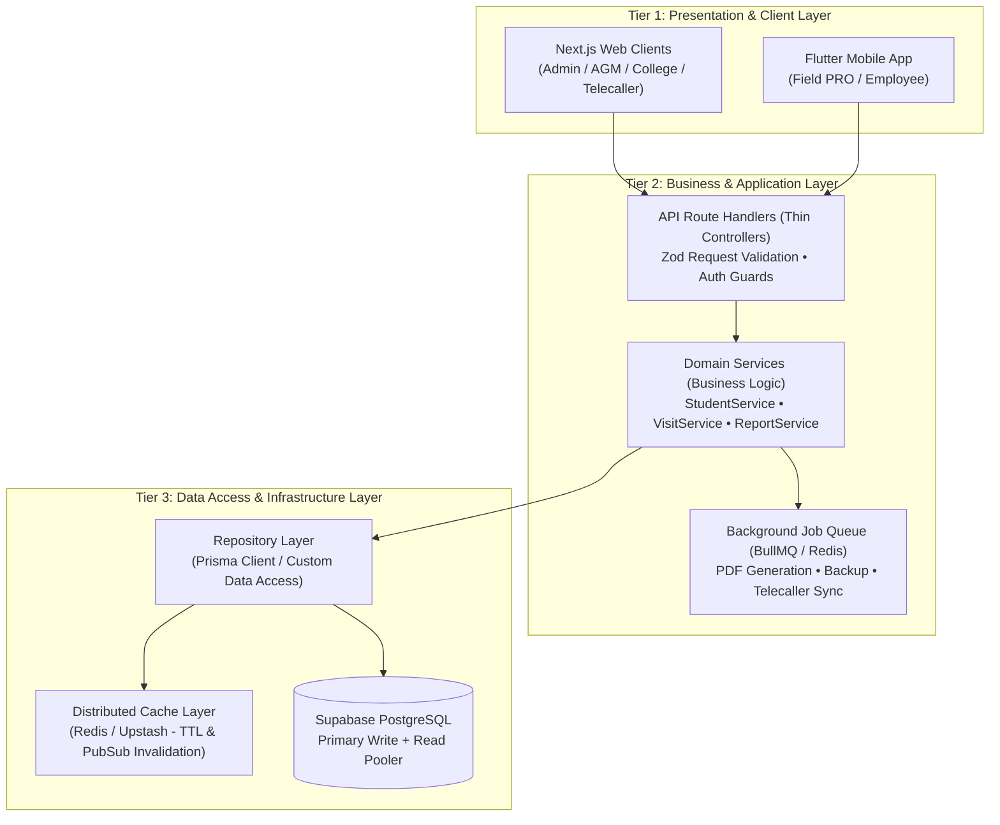
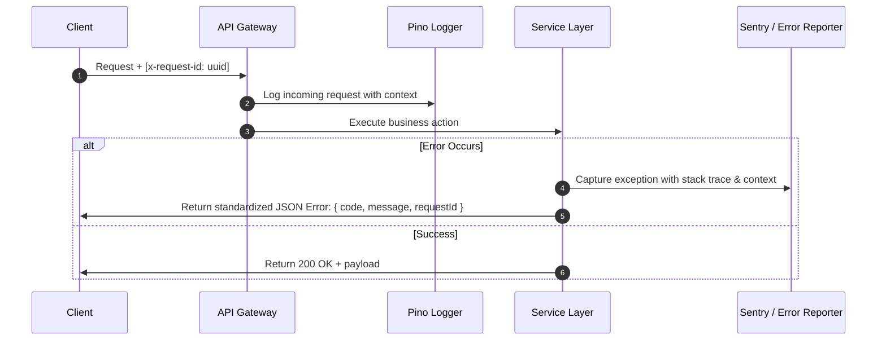

# Admitrack Enterprise Scalability & Architecture Blueprint

This document presents a comprehensive architectural assessment of the **Admitrack** platform (Next.js Backend/Web + Flutter Mobile App + Supabase PostgreSQL), identifying structural bottlenecks and providing an actionable roadmap to transform it into a scalable, high-throughput enterprise application.

---

## 1. Executive Summary & Current Bottlenecks

### Current State
```
┌─────────────────────────────────────────────────────────────────────────┐
│                      CURRENT 1-TIER / TIGHTLY COUPLED                   │
├──────────────────────────┬──────────────────────────────────────────────┤
│ Frontend (Next.js / Web) │ 2,000+ line monolithic pages                 │
│                          │ Inline styles & duplicated business logic    │
├──────────────────────────┼──────────────────────────────────────────────┤
│ API Layer (Next.js API)  │ 62 routes with inline Prisma queries         │
│                          │ Manual validation, mixed auth, mixed SQL     │
├──────────────────────────┼──────────────────────────────────────────────┤
│ Mobile App (Flutter)     │ 1,800+ line ApiService monolith              │
│                          │ 150KB+ UI screens with embedded HTTP calls   │
├──────────────────────────┼──────────────────────────────────────────────┤
│ Data Layer (Supabase PG) │ Single connection pooler, missing multi-node │
│                          │ in-memory caching fallback                   │
└──────────────────────────┴──────────────────────────────────────────────┘
```

### Critical Bottlenecks Identified
1. **Zero Layer Separation (Fat Controllers):** Route handlers (e.g., `src/app/api/students/route.ts` - 549 lines) mix auth, validation, business rules, raw Prisma queries, and response formatting in one place.
2. **Massive Monolithic Files:** 
   - `src/app/college/reports/page.tsx` (2,217 lines)
   - `mobile_app/lib/screens/employee/students_list_screen.dart` (179 KB)
   - `mobile_app/lib/services/api_service.dart` (1,818 lines)
3. **In-Memory Cache Incoherence:** `src/lib/cache.ts` uses local Node.js variables (`cachedConfigs`). In serverless (Vercel) or multi-container setups, each instance has its own stale cache.
4. **Synchronous Heavy Tasks:** PDF generation, large export queries, and bulk data uploads run inside the web server's request-response cycle, creating latency spikes and thread blocking.
5. **No Structured Logging or Tracing:** Plain `console.log` statements with no request IDs or error tracking (Sentry/OpenTelemetry).

---

## 2. Target 3-Tier Architecture



### Recommended Directory Structure

```
src/
├── app/                        # TIER 1: Presentation (Routing only)
│   ├── (auth)/login/
│   ├── (dashboard)/
│   └── api/                    # Thin Controllers (Validate -> Call Service -> Respond)
│       └── v1/
│           ├── students/
│           │   ├── route.ts
│           │   └── [id]/route.ts
├── core/                       # Cross-Cutting Infrastructure
│   ├── config/                 # Env validation with Zod
│   ├── db/                     # Prisma singleton & pool configurations
│   ├── errors/                 # DomainError, NotFoundError, UnauthorizedError
│   ├── logger/                 # Structured Logger (Pino)
│   ├── queue/                  # Background worker client
│   └── redis/                  # Redis client singleton
├── modules/                    # TIER 2 & 3: Domain Modules (DDD)
│   ├── students/
│   │   ├── dtos/               # Zod validation schemas
│   │   │   ├── create-student.dto.ts
│   │   │   └── query-student.dto.ts
│   │   ├── student.service.ts  # Business Rules & Transactions
│   │   └── student.repo.ts     # Pure Prisma / Database Access
│   ├── visits/
│   │   ├── dtos/
│   │   ├── visit.service.ts
│   │   └── visit.repo.ts
│   └── reports/
│       ├── report.service.ts
│       └── report.worker.ts    # Background PDF renderer
└── shared/                     # Reusable UI & Utility Components
    ├── components/
    ├── hooks/
    └── utils/
```

---

## 3. Department-Wise Architectural Recommendations

### Department A: Data Layer & Fast Loading

| Current Issue | Scalable Recommendation | Impact |
|---|---|---|
| **Offset-based pagination (`skip: offset`)** | **Cursor-Based Pagination (`cursor: { id: lastId }`):** Prevents scanning millions of rows on deep pages. | 10x faster student list queries |
| **In-Memory Cache (`src/lib/cache.ts`)** | **Distributed Redis/Upstash Cache:** Cache high-read/low-write data (ConfigValues, Colleges, Branches, School list) with automatic invalidation. | 80% reduction in DB query traffic |
| **Monolithic SELECTs** | **Selective Projection (`select: { id, name }`):** Avoid fetching heavy text fields (`remarks`, photos) in list views. | 5x reduction in JSON payload size |
| **Direct Connections** | **Connection Pooler Tuning:** Enforce Supavisor transaction pooler for API queries and direct connection strictly for migrations. | Zero connection starvation |

#### Cursor-Based Pagination Pattern:
```typescript
// modules/students/student.repo.ts
export async function getStudentsCursor({
  collegeId,
  cursor,
  limit = 20,
}: {
  collegeId?: string;
  cursor?: string;
  limit?: number;
}) {
  return prisma.student.findMany({
    take: limit + 1,
    cursor: cursor ? { id: cursor } : undefined,
    where: collegeId ? { collegeId } : undefined,
    orderBy: { id: 'desc' },
    select: {
      id: true,
      studentName: true,
      phone: true,
      schoolName: true,
      group: true,
      leadStatus: true,
    },
  });
}
```

---

### Department B: Debugging, Observability & Tracing



1. **Structured Logging (Pino / Winston):** Replace all `console.log` / `console.error` with JSON logs containing:
   - `timestamp`, `level`, `requestId`, `userId`, `route`, `latencyMs`.
2. **Correlation ID Middleware:** Attach an `x-request-id` to every incoming request. All database logs, background workers, and client errors reference this ID for instant debugging.
3. **Application Performance Monitoring (APM):** Integrate **Sentry** or **OpenTelemetry** for:
   - Real-time exception capture.
   - Database query latency tracing (pinpointing slow SQL queries).
   - Frontend and Flutter unhandled crash monitoring.

---

### Department C: Crash Recovery & Resilience

1. **Database Reconnect & Retry Logic:** Wrap transient Prisma queries in an exponential backoff wrapper (retrying up to 3 times on connection drops or lock timeouts).
2. **Background Job Offloading:** 
   - Operations like **PDF generation (jsPDF/Puppeteer)**, **bulk student uploads**, and **database backups** must NOT run inside the HTTP thread.
   - Use **BullMQ** or **QStash** to queue heavy tasks, returning a `202 Accepted` job ID immediately.
3. **Rate Limiting & DDoS Protection:**
   - Protect `/api/auth/login` and sensitive search endpoints with Redis-backed rate limiting (`@upstash/ratelimit` or Next.js edge rate limiter: e.g. 5 login attempts per minute per IP).
4. **Health Check Endpoints:**
   - Implement `/api/health` that checks database ping, Redis ping, and memory usage for cloud load balancers.

---

### Department D: Flutter Mobile App Architecture

The Flutter codebase (`mobile_app/`) is currently structured with monolithic screen files containing state, network requests, and UI rendering together.

```
mobile_app/lib/
├── core/
│   ├── network/          # Dio / Http client with interceptors, token refresh & retry
│   ├── storage/          # SecureStorage & SQLite / Isar for offline cache
│   └── theme/
├── features/             # Feature-based folder structure
│   ├── auth/
│   ├── students/
│   │   ├── data/         # API providers & repositories
│   │   ├── domain/       # Student models & entities
│   │   └── presentation/ # State (Riverpod / Bloc) & Widgets
│   └── visits/
```

1. **Adopt Riverpod / Bloc State Management:** Decouple state from widgets. Large screens like `students_list_screen.dart` (179 KB) should be split into modular widgets (FilterBar, StudentCard, StudentList, PaginationLoader).
2. **Offline-First Synchronization (Write-Ahead Log):**
   - Save visits and leads locally in **Isar / SQLite** immediately.
   - A background sync service pushes pending mutations to `/api/sync` when network connectivity is restored.
3. **HTTP Interceptor for Tokens:** Centralize auth tokens and headers in a single HTTP client interceptor rather than passing them manually in every `ApiService` function.

---

## 4. Implementation Phasing Roadmap

| Phase | Focus Areas | Timeline | Key Deliverables |
|---|---|---|---|
| **Phase 1: Foundation & Separation** | • Extract Services & Repositories from `src/app/api/`<br/>• Introduce Zod DTOs for request validation<br/>• Standardize API error responses | Sprint 1-2 | Clean 3-Tier backend structure, zero Prisma in route handlers |
| **Phase 2: Performance & Caching** | • Implement Redis distributed cache<br/>• Migrate student lists to cursor pagination<br/>• Optimize Prisma index usage | Sprint 3 | 5x faster list loading, sub-100ms API response times |
| **Phase 3: Observability & Resilience** | • Add Pino structured logging & Request ID<br/>• Integrate Sentry for crash tracking<br/>• Setup BullMQ worker for PDF generation | Sprint 4 | Zero server crashes on heavy PDF/export loads, instant debugging |
| **Phase 4: Mobile App Modernization** | • Refactor `mobile_app` into feature modules<br/>• Implement Riverpod / Bloc state management<br/>• Robust offline sync engine | Sprint 5-6 | Smooth 60 FPS mobile UI, reliable field data collection |
